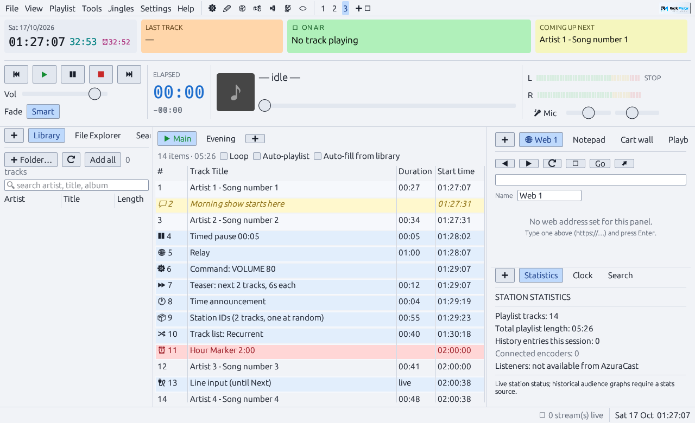
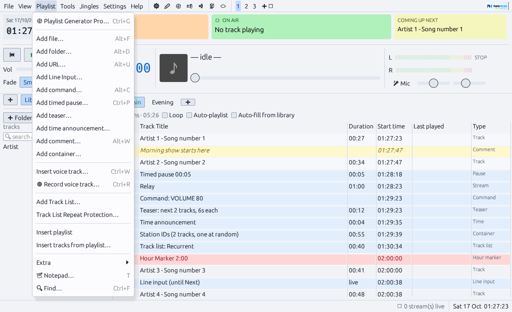
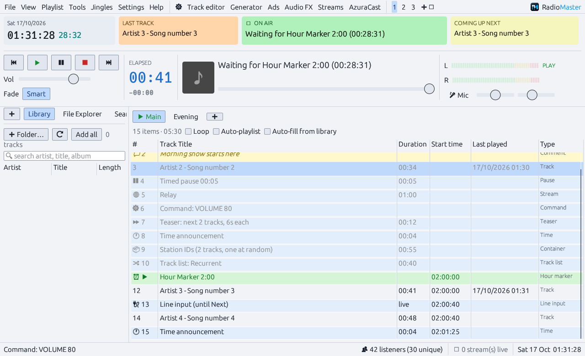
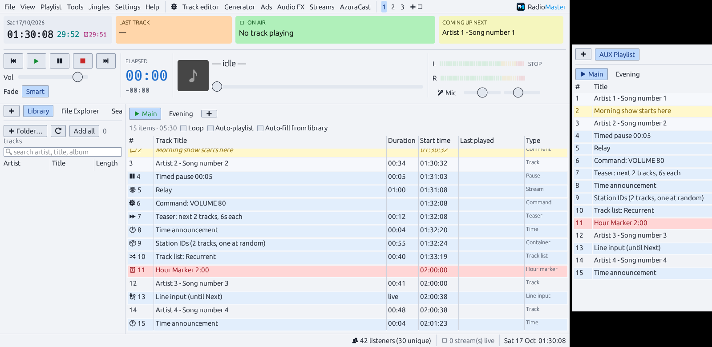
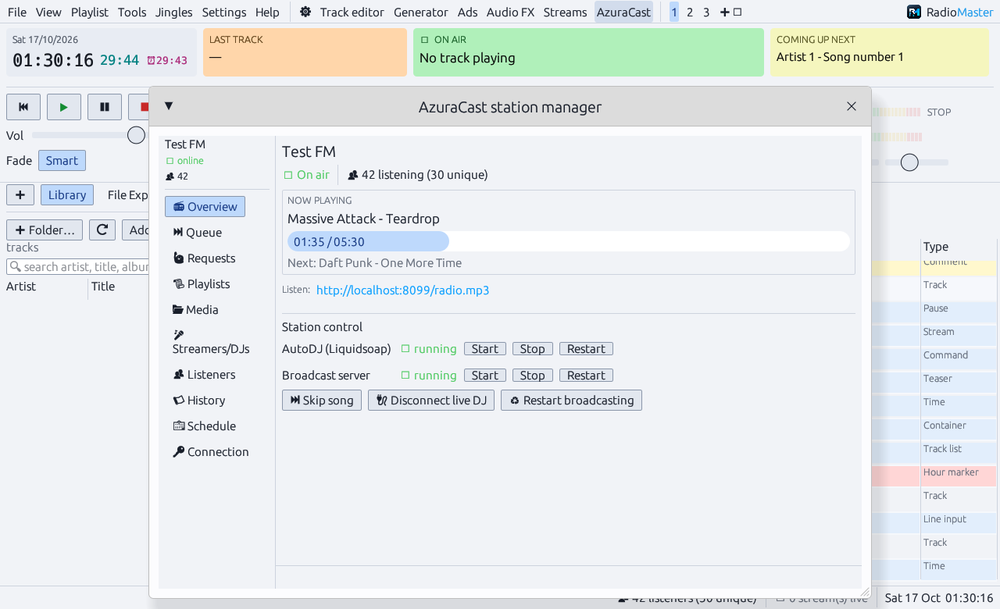

  

<b>Radio automation for Windows, macOS and Linux, written in Rust.</b> 
Playlists, hour markers, smart crossfades, Icecast / Shoutcast streaming and AzuraCast station management in one studio app.

  <a href="https://epell-development.github.io/RadioMaster/">Website</a> ·
  <a href="../../releases/latest">Download</a> ·
  <a href="#playlists">Playlists</a> ·
  <a href="#work-zones">Work zones</a> ·
  <a href="#azuracast-station-manager-tools--azuracast-optional">AzuraCast</a>

RadioMaster uses a classic broadcast-automation layout: playlist tabs in the centre, transport,
VU meters and the Last / On Air / Next tiles on top, panels around it, and tools in their own windows.

## Download
From the [latest release](../../releases/latest):
- **`RadioMaster-Setup-<version>.exe`** — installer with Start-menu / desktop shortcuts and an uninstaller
  (install just for you, no admin needed, or for all users), or
- **`RadioMaster-<version>-windows-x64.zip`** — portable: unzip anywhere and run `RadioMaster.exe`.
- **`RadioMaster-<version>-macos.zip`** — RadioMaster.app for macOS 12+ (see [macOS and Linux](#macos-and-linux)).
- **`RadioMaster-<version>-linux-x64.tar.gz`** — unpack and run `./RadioMaster`.

On first start you create the local administrator account. RadioMaster tells you when a new version is out
(the button next to the logo); installed copies update themselves in one click.
Embedded web panels use the Microsoft Edge WebView2 runtime, which Windows 10/11 already include.

## Build from source (Windows)
Double-click **`run-windows.bat`** (or `cargo run --release` in this folder).
**`build-windows.bat`** produces `target\release\RadioMaster.exe` (with the RadioMaster icon).
**`build-installer.bat`** also makes `dist\RadioMaster-Setup-<version>.exe` (needs [Inno Setup 6](https://jrsoftware.org/isdl.php)).

Linux: `sudo apt install build-essential libasound2-dev pkg-config`, then `cargo run --release`.
macOS: install Rust, then `cargo run --release`.

Settings, playlists, layout and `history.csv` live in `%APPDATA%\RadioMaster` (settings from an older
OpenBoss install are copied across on first start). If the program ever crashes, the reason is in `crash.log` there.

## Playlists
- As many playlist tabs as you like (the ▶ tab is on air). Double-click a tab to rename it; right-click for
  Put on air, Duplicate, Save/Load M3U, move, Clear, Close. Playing any row of another tab puts that tab on air.
- Columns: #, Track Title, Duration, Start time (projected air time, hour markers included), Last played, Type.
- Right-click rows: Play now, Track editor / Edit…, Move up/down, Copy/Move to another playlist, Upload to AzuraCast, Remove.

### Playlist menu
| Item | What it does |
|---|---|
| Playlist Generator Pro… (Ctrl+G) | category/template generator |
| Add file / folder / URL (Alt+F / Alt+D / Alt+U) | URL = relay an internet stream for a set time or until Next |
| Add Line Input… | play the input device live (for a set time or until Next) |
| Add command… (Alt+C) | `STOP`, `PAUSE`, `VOLUME 80`, `ENCODER START 1`, `ENCODER STOP 1`, `LOAD file.m3u`, `PLAYLIST name`, `RUN program args` |
| Add timed pause… (Ctrl+P) | silence for a set time |
| Add teaser… | faded snippets of the next N tracks |
| Add time announcement… | recordings H00…H23 / M00…M59 from a folder, otherwise the computer's speech voice reads your text (`{h12}:{mm} {ampm}`) |
| Add text to speech… (Alt+T) | reads your text, every line: {time}, {next}, {last}, {station}…; voice, speed, pitch, volume, pause between lines, repeat, intro/outro sound |
| Add comment… (Alt+W) | a note row; nothing plays |
| Add container… | several files as one row: all in order, or one at random |
| Insert voice track (Ctrl+W) / Record voice track (Ctrl+R) | recordings go to `voicetracks\` |
| Add Track List… + Track List Repeat Protection… | each time the row is reached, one random track from a folder/M3U that hasn't played recently (track and artist minutes) |
| Insert playlist / Insert tracks from playlist… | insert an M3U after the selection, or pick tracks from it |
| Extra ▸ | hour marker, shuffle, sort, reverse, remove duplicates / played / missing, render WAV, export CSV, clear |
| Notepad… (T), Find… (Ctrl+F) | |

Hour markers: *wait* (silence until the time if early), *soft* (finish the current track, then jump) or *hard* (cut in on time).
The clock shows the countdown to the next marker.

## Work zones
View → Work zones, the **1 2 3** buttons, or **Ctrl+1/2/3** set how many panels the main window has
(1 = playlist + left panel, 2 = + right panel, 3 = + lower-right panel). **Ctrl+4 / ➕🗖** opens an
**Additional** window — a real window with its own tabbed panel. Open as many as you like and put them on other
screens; they reopen where you left them. Each panel's ➕ adds AUX Playlist, Cart wall, Search, Scheduler,
File Explorer, Notepad, Statistics, Song Requests, Playback Queue, Log, Library, Clock, Track Info or a web panel.
Right-click a tab to move it to another panel or into a new Additional window.

Web panels: type an address and give the tab a name. **➕ → New web panel** adds as many as you like. On a fresh
install the first one opens https://radiomanager.dovafm.com.

## AzuraCast station manager (Tools → AzuraCast, optional)
Connection: server address + station (or *Find stations on this server*). Now playing and listener counts need no key.
With an **API key** (AzuraCast → your account → API Keys) you also get:
Overview (start/stop/restart AutoDJ and broadcast server, skip, disconnect live DJ, restart broadcasting) ·
Queue (remove) · Requests (pending list, delete, clear, add to the local playlist, request songs) ·
Playlists (enable/disable, reshuffle, queue) · Media (browse, upload here, new folder, queue next, delete) ·
Streamers/DJs (add, edit, delete, fill encoder) · Listeners · History · Schedule.
The **Song Requests** panel tab shows the same request list.

## Going on air with AzuraCast
1. AzuraCast → Streamers/DJs: create an account (or do it in the manager) and note the DJ port.
2. Tools → Streams → *AzuraCast DJ preset*, fill host, port, username, password → **Connect**.

## Also included
Two-deck crossfading with smart fading and a waveform track editor (cues, fades, intro/outro), cart wall, mic with ducking,
multiple outputs, 12-band EQ / compressor / leveling, ad scheduler, event scheduler, rotations, reports, metadata export,
remote control HTTP API, station profiles, local operator accounts.

## Adverts and jingles (Tools → Advertisement scheduler)
**Rules** say what plays (an advert / jingle folder, chosen files, or the Adverts list), how often (after every N
songs, every N minutes or hours, or at set times) and when the rule is in force (dates, days, hours). The **Adverts
list** holds your adverts with the dates and days each may run. Rules can also be used in the playlist generator
(as a pattern step or inserted every N minutes) and run by the Event scheduler or the `RULE <name>` command.

## Event scheduler (Tools → Event scheduler, F3)
At a set time (on chosen days and dates): generate a new playlist from a template, append one, play a rule's
adverts / jingles, put a playlist tab on air, load an M3U, play a file, start / stop encoders, set the volume, or
run any station command.

## Streaming formats
MP3 is built in. AAC, Opus, Ogg Vorbis and FLAC are made by [ffmpeg](https://ffmpeg.org/download.html) — put
`ffmpeg` next to RadioMaster, in the settings folder's `ffmpeg` folder, or on the PATH, or choose it in Streams.
**Custom encoder** runs any program you give it: it receives 16-bit 44.1 kHz stereo PCM on stdin and writes the
stream to stdout (`{bitrate}` is replaced with the bitrate).

## Reports (Tools → Reports)
Pick **Everything, Songs, Adverts, Jingles** or **Speech, voice & other**, a period (Today, This week, Last month…
or any dates), and optionally only items containing a word. Click an item to see every time it played.
**📄 PDF…** saves a report with totals, plays per day and every item; **⬇ Export** also has CSV (opens in Excel),
every single play, and **proof of play** PDFs — for the selected advert or jingle, or each item on its own page,
with every air time and lines to sign. Plays are read from `history.csv` in the settings folder.

## Microphone
The 🎤 Mic button (Ctrl+M) puts your input on air. Right-click it (or Settings → Audio) to choose what the music
does meanwhile: lowered to the level of the slider next to the mic volume, muted, or paused until the mic goes off.

## Plugins
Small programs in any language that run when something happens on air, and can send commands back.
See [PLUGINS.md](PLUGINS.md) and **Tools → Plugins**.

## Translations
Settings → General → Language. To translate RadioMaster, see [lang/README.md](lang/README.md).

## Users and permissions
File → Users: administrators can add operators and choose what each one may do — playback, jingles,
editing playlists, streaming and settings — and exactly which tools they can open (track editor, generator,
adverts, Audio FX, AzuraCast, reports, history, notepad, plugins, scheduler, voice tracks, library, file explorer,
song requests, web panels). They can also reset passwords and disable or delete accounts.

## macOS and Linux
Each release also has `RadioMaster-<version>-macos.zip` (RadioMaster.app; unsigned, so right-click → Open the
first time) and `RadioMaster-<version>-linux-x64.tar.gz`. Embedded web panels are Windows-only for now; elsewhere
they open in your browser.

## Contributing
Bug reports and pull requests are welcome — see [CONTRIBUTING.md](CONTRIBUTING.md).

## License
[MIT](LICENSE).

RadioMaster is an independent project. It is not affiliated with or endorsed by DJSoft.net (RadioBOSS) or AzuraCast;
those names are used only to describe compatibility and familiar workflows.
